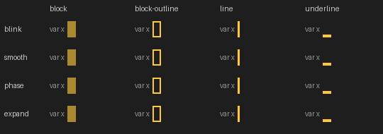

# VSNeo — a real Neovim inside Visual Studio

**Not a Vim emulator.** VSNeo runs your own `nvim.exe` headless inside Visual Studio and lets it drive the standard editor. Every motion, operator, text object, register, macro and `:command` is executed by Neovim itself. Visual Studio keeps what it is best at: rendering, IntelliSense, Roslyn refactorings, Copilot and undo.

## What you get

- **Real Vim semantics** — modes, motions, operators, counts, registers, marks, macros, visual and replace mode, executed by Neovim and applied back into Visual Studio as ordinary edits.
- **The whole command line** — `:%s/a/b/g`, `:g`, `:normal` and every other ex command, because Neovim runs them.
- **`.` and macros replay what you typed in insert mode**, not just the operator.
- **Your own config** — `~/.vsneorc` (Vimscript) or `~/.vsneorc.lua`, with Neovim plugins such as surround, commentary and text objects loaded from `~/.vsneo/pack`.
- **Any Visual Studio command from a mapping** — `:Vsc Build.BuildSolution`, by the name in Tools > Options > Keyboard.
- **One undo history: Visual Studio's.** `u` undoes one Vim change at a time, including a Roslyn rename or a format.
- **A floating `:` and `/` command line** with wildmenu completion, and a pager for long output.
- **Neovim's regex search**, highlighted in the editor with a `[3/12]` counter and scrollbar ticks.
- **Folding is Visual Studio outlining** driven by `za`, `zo`, `zc`, `zR`, `zM`, `zf`.
- **`gd`, `gr`, `gi`, `K`, `<leader>rn`, `<leader>ca`** pre-wired to Roslyn navigation and refactorings. `Ctrl-O`/`Ctrl-I` walk Visual Studio's navigation history.
- **Code-aware text objects and motions** — `af`/`if` (function), `ac`/`ic` (class), `]m`/`[m` and `]]`/`[[`, from the language service's own syntax tree.
- **Splits and tabs** — `Ctrl-W h/j/k/l`, `:split`, `:vsplit`, `:e`, `:b`, `gb` to jump to any tab by letter.
- **A Telescope-style fuzzy picker, built in** — files, live grep, symbols, document outline, git-modified files, with a preview pane and frecency ranking. Works in insert mode too.
- **Flash-style `s` jump** with letter labels, register and mark peek, a which-key popup for pending prefixes.
- **Insert mode stays Visual Studio's.** IntelliSense, snippets, Copilot and brace completion are untouched.
- **Looks** — Neovide-style cursor trail, custom per-mode cursors, smooth scrolling, relative line numbers, and one-command presets: `:VSNeoPreset neovide`, `tokyo_night`, `catppuccin_mocha`, `blade_runner`, `matrix`, `cyberpunk2077`. [Previews and every option.](https://github.com/knilecrack/VSNeo/blob/master/docs/visual-features.md)

## Requirements

- Windows, Visual Studio 2022 **17.14+** or Visual Studio 2026.
- [Neovim](https://neovim.io) **0.10+** on `PATH`, or pointed at with `VSNEO_NVIM_PATH` / Tools > Options > VSNeo > Neovim path. Developed against 0.12.

## 60-second start

1. Install, open any code file, look for **VSNeo: connected** in the status bar.
2. `gg`, `%`, `ci"`, `vap`, `.` behave exactly as in Vim.
3. `:` and `/` open the floating command line. `Tab` completes.
4. Map anything: `nnoremap <leader>b :Vsc Build.BuildSolution<CR>` in `~/.vsneorc`.

Full configuration, plugin loading and troubleshooting: [README on GitHub](https://github.com/knilecrack/VSNeo#configuration). Bugs and ideas: [issues](https://github.com/knilecrack/VSNeo/issues). MIT licensed.
